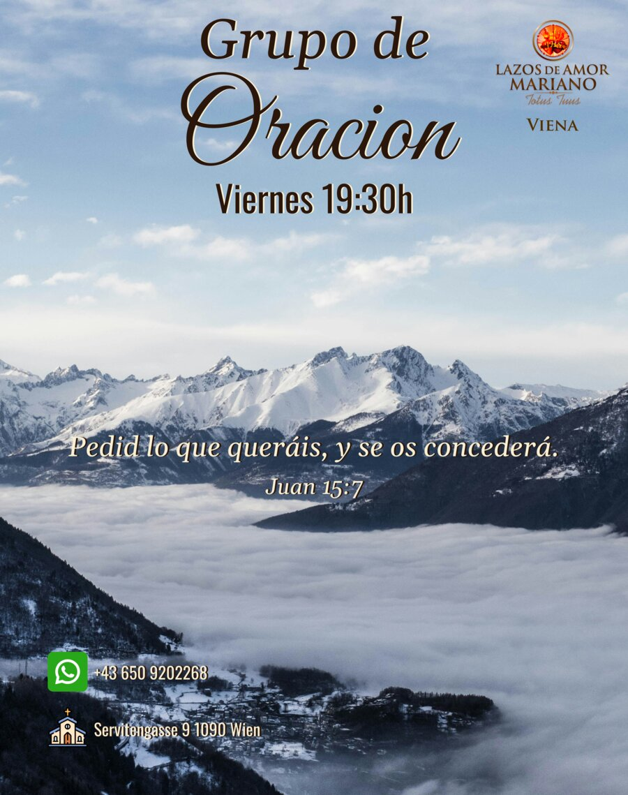
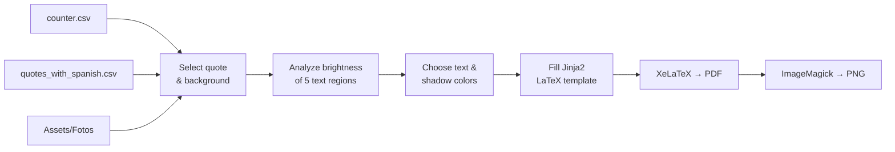

<div align="center">

# 🖼️ Automated Poster Generator

**Generate print-ready event posters automatically, with a new background and a new quote each time.**

[](https://www.python.org/)
[](https://www.latex-project.org/)
[](https://jinja.palletsprojects.com/)
[](#-requirements)



*Example output: a 79 × 100 cm poster rendered as PDF and 300 DPI PNG.*

</div>

---

## 📖 Table of Contents

- [About](#-about)
- [Features](#-features)
- [How It Works](#-how-it-works)
- [Project Structure](#-project-structure)
- [Requirements](#-requirements)
- [Installation](#-installation)
- [Usage](#-usage)
- [Customization](#-customization)
- [Troubleshooting](#-troubleshooting)
- [Contributing](#-contributing)

---

## 💡 About

**Automated Poster Generator** builds the weekly poster for a prayer group (*Grupo de Oración*). Each time you run it, it:

1. picks the **next background photo** from a collection,
2. picks the **next Bible quote** from a list of about 100 (in Spanish and English),
3. **analyzes the photo's brightness** so every piece of text gets a readable color,
4. renders a **high-resolution poster** with XeLaTeX and exports it as **PDF and PNG**.

So instead of designing a new poster by hand every week, you run one command.

---

## ✨ Features

| Feature | Description |
|---|---|
| 🔄 **Automatic rotation** | Moves through backgrounds and quotes in order, so no combination repeats right away. |
| 🎨 **Smart text colors** | Measures the brightness of each text area of the photo and chooses cream, black or dark brown, each with a contrasting shadow. |
| 🌍 **Bilingual quotes** | The quote list contains Spanish and English versions. Spanish is used by default. |
| 🖨️ **Print quality** | Produces a 79 × 100 cm vector PDF plus a 300 DPI PNG for sharing on social media or WhatsApp. |
| 🧩 **Template-based** | The layout is a normal LaTeX file with Jinja2 placeholders, easy to restyle. |
| 🔤 **Bundled fonts** | Great Vibes, Gelasio and Oswald are included. Nothing needs to be installed system-wide. |

---

## ⚙️ How It Works



1. **State tracking**: `Code/counter.csv` stores the current position in the quote list and the photo collection. Each run appends a new row, which gives you a full history of posters you've generated.
2. **Brightness analysis**: the background is divided into five regions (*Grupo de*, *Oración*, *Viernes 19:30h*, the quote and the reference). For each region the average [relative luminance](https://en.wikipedia.org/wiki/Relative_luminance) is calculated:

   | Average brightness | Text color | Shadow |
   |---|---|---|
   | `< 120` (dark area) | Cream `#F8EFD4` | Dark brown |
   | `120 – 160` (medium) | Black `#000000` | Cream |
   | `≥ 160` (light area) | Dark brown `#2A160B` | Cream |

3. **Rendering**: Jinja2 fills `Latex-Poster/Latexcode.tex` with the chosen photo, quote and colors. XeLaTeX compiles it, and ImageMagick converts the PDF to PNG.

---

## 📁 Project Structure

```
Automated-poster-generator/
├── Code/
│   ├── Automation Code.py        # Main script: run this
│   ├── snipets_test.py           # Scratch/test snippets
│   └── counter.csv               # Rotation state (quote & background counters)
├── Latex-Poster/
│   └── Latexcode.tex             # Jinja2 + LaTeX poster template
├── Assets/
│   ├── Fotos/                    # Background photos: backgroundfoto1.jpg … backgroundfotoN.jpg
│   ├── Quotes/
│   │   └── quotes_with_spanish.csv  # Bible quotes (EN + ES)
│   ├── Logos/                    # Group logo, WhatsApp & church icons
│   └── Fonts/                    # Great Vibes, Gelasio, Oswald (OFL licensed)
├── output/                       # Generated poster (.tex, .pdf, .png)
├── docs/
│   └── preview.jpg               # Image used in this README
└── requirements.txt
```

---

## 📋 Requirements

| Tool | Purpose | Notes |
|---|---|---|
| **Python 3.10+** | Runs the generator | Developed on Python 3.12 |
| **XeLaTeX** | Compiles the poster | Needs the `fontspec`, `tikz`, `xcolor`, `geometry` and `adjustbox` packages |
| **ImageMagick** + **Ghostscript** | Converts PDF → PNG | Provides the `convert` command |
| Python packages | Image analysis & templating | `Pillow`, `numpy`, `Jinja2` (see [`requirements.txt`](requirements.txt)) |

> [!NOTE]
> The project was developed and tested on **Linux**. It should also work on macOS. On Windows, use WSL or make sure `xelatex` and `convert` are on your `PATH`.

---

## 🚀 Installation

### 1. Clone the repository

```bash
git clone https://github.com/Wasauski669/Automated-poster-generator.git
cd Automated-poster-generator
```

### 2. Install the system tools

**Ubuntu / Debian**

```bash
sudo apt update
sudo apt install texlive-xetex texlive-latex-extra texlive-pictures imagemagick ghostscript
```

**macOS (Homebrew)**

```bash
brew install --cask mactex-no-gui
brew install imagemagick ghostscript
```

### 3. Create a virtual environment and install the Python packages

```bash
python3 -m venv .venv
source .venv/bin/activate
pip install -r requirements.txt
```

### 4. Check the installation

```bash
xelatex --version && convert --version && python -c "import PIL, numpy, jinja2; print('All good!')"
```

---

## ▶️ Usage

Generate the next poster with:

```bash
python "Code/Automation Code.py"
```

The script finds its files relative to its own location, so you can run it from any folder.

**Output** (written to `output/`):

| File | Use it for |
|---|---|
| `Poster-output.pdf` | Printing (vector, 79 × 100 cm) |
| `Poster-output.png` | Sharing online / WhatsApp (300 DPI) |
| `Poster-output.tex` | The filled-in LaTeX source, useful for debugging |

**Example console output** (shortened; values vary per run)

```text
c_quote_es: 6
reference: Juan 15:7
quote: Pedid lo que queráis, y se os concederá.
Bg Foto:  .../Assets/Fotos/backgroundfoto9.jpg
COLOR BRIGHTNESS:  [182.4, 171.9, 165.0, 98.7, 102.3]
generated poster successfully.
Runtime: 14.82 seconds
```

> [!TIP]
> Every run moves to the next quote and background. To **regenerate the same poster**, delete the last two lines of `Code/counter.csv` before running again.

---

## 🎨 Customization

### Add background photos

Put new images in `Assets/Fotos/` and keep the naming sequence going:

```
backgroundfoto30.jpg, backgroundfoto31.jpg, ...
```

Portrait images with a **79:100 aspect ratio** (e.g. 2370 × 3000 px) fit the poster best.

### Add or edit quotes

Add rows to `Assets/Quotes/quotes_with_spanish.csv`. The file needs these four columns:

```csv
Reference,Quote,References_es,Quotes_es
John 15:7,"Ask whatever you wish, and it will be done for you.",Juan 15:7,"Pedid lo que queráis, y se os concederá."
```

When the end of the list is reached, quotes start again from the top.

### Choose which quote and photo come next

Append a row to `Code/counter.csv`. The script always reads the **last row**:

```csv
counter_quote,counter_background,counter_quote_es
0,1,0
```

- `counter_background`: number of the next photo (`1` → `backgroundfoto1.jpg`)
- `counter_quote_es`: index of the next quote (row number in the quote file, starting at `0`)

### Change the event text, address or phone number

The fixed text is in `Latex-Poster/Latexcode.tex`. Search for and replace:

- `Grupo de`, `Oracion`, `Viernes 19:30h`: poster title and meeting time
- `Servitengasse 9 1090 Wien`: address
- `+43 650 9202268`: contact number

Each text appears **twice**, once for the text and once for its shadow, so change both.

### Use English quotes

`Automation Code.py` already includes `load_quotes_en()`. In `main()`, replace

```python
references_es, quotes_es = load_quotes_es()
```

with

```python
references_es, quotes_es = load_quotes_en()
```

### Adjust the colors

The colors are defined at the top of the template:

```latex
\definecolor{cream}{HTML}{F8EFD4}
\definecolor{darkbrown}{HTML}{2A160B}
```

The brightness thresholds (`120` and `160`) are in `chose_color()` in `Automation Code.py`.

---

## 🛠️ Troubleshooting

<details>
<summary><b><code>RuntimeError: No background Images</code></b></summary>

The counter points to a photo that doesn't exist, e.g. `backgroundfoto30.jpg` after the last photo has been used. Either add more photos, or start over by appending a row such as `0,1,0` to `Code/counter.csv`.
</details>

<details>
<summary><b><code>RuntimeError: xelatex failed</code></b></summary>

- Make sure `xelatex` is installed and on your `PATH`.
- Read the LaTeX log printed in the console, or open `output/Poster-output.log`.
- A missing package (e.g. `tikz.sty not found`) means you need the extra TeX Live packages from the [installation step](#2-install-the-system-tools).
</details>

<details>
<summary><b><code>convert: attempt to perform an operation not allowed by the security policy 'PDF'</code></b></summary>

Some Linux distributions block PDF conversion in ImageMagick by default. Edit `/etc/ImageMagick-6/policy.xml` and change

```xml
<policy domain="coder" rights="none" pattern="PDF" />
```

to

```xml
<policy domain="coder" rights="read|write" pattern="PDF" />
```
</details>

<details>
<summary><b><code>ModuleNotFoundError: No module named 'PIL'</code></b></summary>

Activate the virtual environment (`source .venv/bin/activate`) and run `pip install -r requirements.txt`.
</details>

---

## 🤝 Contributing

Suggestions and bug reports are welcome. Please use the [issue templates](https://github.com/Wasauski669/Automated-poster-generator/issues/new/choose) to:

- 🐛 **Report a bug**
- 💡 **Request a feature**

Pull requests are welcome too. For larger changes, please open an issue first to discuss what you'd like to change.

---

## 🙏 Credits

- **Fonts**: [Great Vibes](https://fonts.google.com/specimen/Great+Vibes), [Gelasio](https://fonts.google.com/specimen/Gelasio) and [Oswald](https://fonts.google.com/specimen/Oswald), licensed under the [SIL Open Font License](https://openfontlicense.org/) (license files included in `Assets/Fonts/`).
- Built with [Python](https://www.python.org/), [Jinja2](https://jinja.palletsprojects.com/), [Pillow](https://python-pillow.org/), [NumPy](https://numpy.org/), [XeLaTeX](https://tug.org/xetex/) and [ImageMagick](https://imagemagick.org/).

<div align="center">

Made with ❤️ by [Wasauski669](https://github.com/Wasauski669)

</div>
